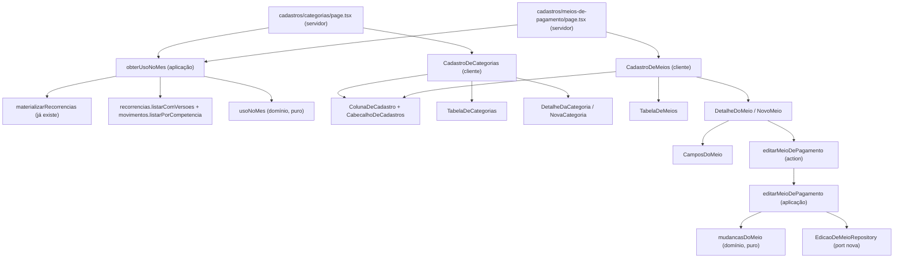

# Cadastros em abas, com o item aberto à direita: Design

Spec: `spec.md` (CADCOL-01 a CADCOL-12). Protótipo aprovado: "A · Abas, linhas e detalhe numa coluna
à direita" do canvas do dono. Os precedentes são Todo mês em linhas (AD-021, ainda em plano, em
`.worktrees/todo-mes-colunas`) e Lançamentos em lista densa (AD-020): coluna a partir de 1.536 px,
lista com até 1.100 px, painel que muda de lugar por CSS. O mapa de impacto abaixo foi lido no código
desta worktree (`514ab25`), com `file:line`, e confere as notas do protótipo.

## Abordagens consideradas

Todas entregam o mesmo escopo; a escolhida é a primeira.

1. **Duas rotas, uma `ColunaDeCadastro` própria desta fatia (escolhida).** Categorias continua em
   `cadastros/categorias`, e Meios de pagamento nasce em `cadastros/meios-de-pagamento`. As duas
   abas usam a mesma grade e o mesmo invólucro de painel, feitos aqui. Não depende de nenhum código
   de Todo mês.
2. **Uma rota com `?aba=`.** Uma página leria os dois cadastros sempre, e a aba competiria com
   `?categoria=` e `?meio=` na mesma URL. Descartada.
3. **Reusar a grade de Todo mês.** Todo mês desenha a grade dentro de `TodoMes`, presa ao estado
   dele; extrair uma peça comum mexeria numa fatia que ainda não foi aprovada. Fica para depois,
   quando as três telas estiverem no `main` (Risks).

## Arquitetura



As páginas continuam lendo no servidor e entregando os itens prontos para a tela. O que muda:
- **O uso no mês** sai de uma função pura do domínio, alimentada por um caso de uso que materializa
  e lê (CADCOL-03).
- **A edição do meio** é um caso de uso novo, com a regra de "o que mudou" no domínio e uma port de
  escrita estreita (CADCOL-07).
- **Cada aba é um componente cliente só**, porque o "+ Nova…", as linhas e o painel dividem o mesmo
  estado: o que está aberto.

## A regra do uso: `usoNoMes` (CADCOL-03)

`src/domain/cadastro/uso-no-mes.ts`, pura, exportada em `src/domain/index.ts`:

```ts
export interface UsoDoCadastro {
  readonly fixos: number;
  readonly lancamentos: number;
}

export const SEM_USO: UsoDoCadastro = { fixos: 0, lancamentos: 0 };

export interface UsoNoMes {
  /** Por id de categoria; categoria sem uso fica fora do mapa. */
  readonly porCategoria: ReadonlyMap<string, UsoDoCadastro>;
  /** Por id de meio; meio sem uso fica fora do mapa. */
  readonly porMeio: ReadonlyMap<string, UsoDoCadastro>;
}

export function usoNoMes(
  recorrencias: readonly Recorrencia[],
  lancamentos: readonly Lancamento[],
  competencia: Competencia,
): UsoNoMes;
```

As regras, uma por ramo:
1. **Fixo do mês:** `janelaMaterializacao({ inicio, fim }, competencia, competencia).length === 1`.
   É a mesma função que decide se o mês tem ocorrência do fixo, e não uma segunda definição das
   bordas (AC 1 e 2). Conta para `recorrencia.meioPagamentoId` sempre, e para
   `recorrencia.categoriaId` quando não é nula (AC 6). A materialização ainda pula o mês anterior a
   toda vigência (`materializar/handler.ts:57-61`), mas esse mês não existe dentro do período: a
   primeira vigência nasce junto com o fixo, no início (`RecorrenciaRepository.criar`), e uma vigência
   nova não vale antes do início (EDF-03, AC 5). Período e ocorrência coincidem.
2. **Lançamento do mês:** `lancamento.competencia === competencia` e `canceladoEm === null`. O
   repositório já entrega só esses (`movimento.repository.ts:27-36`); a função confere de novo para
   não depender de quem chama. Conta para o meio sempre, e para a categoria quando não é nula, de
   qualquer natureza e origem (AC 3 e 6).
3. **Nenhuma soma:** só contagem de linhas. Nenhum valor de `movimento`, `recorrencia_versao` ou
   `compra_parcelada` é lido (AD-003).

Por que a contagem de lançamentos é por igualdade de id, e não pelo `daCategoria` de
`filtrar-lancamentos.ts:65-70`: com um id de verdade, `daCategoria` é exatamente
`categoriaId === id`; o ramo `SEM_CATEGORIA` não se aplica a uma categoria cadastrada. A concordância
é provada no caso de uso (abaixo), e não suposta.

## A leitura: `obterUsoNoMes` (CADCOL-03, AC 4 e 5)

`src/application/cadastros/obter-uso-no-mes/handler.ts`:

```ts
export interface DependenciasUsoNoMes {
  readonly recorrencias: RecorrenciaRepository;
  readonly movimentos: MovimentoRepository;
}
export async function obterUsoNoMes(
  deps: DependenciasUsoNoMes,
  competencia: Competencia,
): Promise<UsoNoMes>;
```

1. `materializarRecorrencias(deps, competencia, MESES_DE_PROJECAO)`, a mesma chamada de
   `lancamentos/page.tsx:125-129`.
2. Depois dela, e não em paralelo, `listarComVersoes()` e `listarPorCompetencia(competencia)`.
3. `usoNoMes(todas.map((r) => r.recorrencia), lancamentos, competencia)`.

**Testes:**
- **Unit, com os fakes** de `@/application/ports/fakes`:
  - num mês nunca aberto, a ocorrência do fixo entra em `lancamentos`; trocar a ordem dos passos, ou
    apagar a materialização, derruba a contagem;
  - a concordância (L-014): para cada categoria e cada meio da fixture, `lancamentos` é igual a
    `filtrarLancamentos((await obterVisaoMensal(fakes, competencia)).lancamentos, { categoriaId })`
    `.length`, e o mesmo com `meioPagamentoId`. A fixture tem um avulso cancelado, um de abril, uma
    parcela, uma receita fixa sem categoria e um fixo encerrado em fevereiro: cada um é um ramo em
    que as duas contagens poderiam divergir.
- **Integração, com Postgres** (`handler.integration.test.ts`, como `materializar`): um fixo inserido
  sem ocorrência, um avulso cancelado e um de abril; as contagens de março saem certas, e chamar duas
  vezes não duplica ocorrência.

## A edição do meio (CADCOL-07)

### A regra: `mudancasDoMeio`

`src/domain/cadastro/mudancas-do-meio.ts`, pura, exportada em `src/domain/index.ts`:

```ts
export interface CicloDoCartao {
  readonly diaFechamento: number;
  readonly diaVencimento: number;
}

export interface PedidoDeEdicaoDoMeio {
  /** Já normalizado pelo schema (`nome.ts`). */
  readonly nome: string;
  /** Só no cartão; `null` na conta e no rótulo. */
  readonly ciclo: CicloDoCartao | null;
}

export interface MudancasDoMeio {
  readonly nome?: string;
  readonly diaFechamento?: number;
  readonly diaVencimento?: number;
}

/** `ok(null)` quando nada mudou. */
export function mudancasDoMeio(
  atual: MeioPagamento,
  pedido: PedidoDeEdicaoDoMeio,
): Result<MudancasDoMeio | null, DomainError>;
```

Os ramos:
1. `geraFatura(atual)` e `ciclo === null`, ou não `geraFatura(atual)` e `ciclo !== null`:
   `err({ code: "CICLO_NAO_CORRESPONDE_AO_TIPO" })` (AC 11). O código entra na união fechada de
   `src/domain/shared/result.ts:33-45`, e a mensagem em `src/lib/erros.ts`, no mesmo commit: todo
   código do domínio é exibível, e sem a mensagem o `Record` não compila.
2. Nome diferente, por igualdade estrita: entra `nome`. A caixa conta, e é assim que "cartão roxo"
   vira "Cartão Roxo" (AC 8).
3. No cartão, cada dia diferente entra sozinho.
4. Nada diferente: `ok(null)` (AC 9).
5. O tipo nunca aparece em `MudancasDoMeio` (AC 4).

### A port de escrita: `EdicaoDeMeioRepository`

Em `src/application/ports/repositories.ts`, separada de `CadastroRepository`:

```ts
/**
 * Só a tela de Cadastros edita meio. Separada de `CadastroRepository` para que
 * nenhum caso de uso de mês, de compra ou de importação receba esse poder
 * (`cadastro.repository.ts:17-22`).
 */
export interface EdicaoDeMeioRepository {
  buscarMeioDePagamento(id: string): Promise<MeioPagamento | null>;
  buscarMeioDePagamentoAtivoPorNome(nome: string): Promise<MeioPagamento | null>;
  atualizarMeioDePagamento(id: string, mudancas: MudancasDoMeio): Promise<MeioPagamento>;
}
```

`CadastroRepositoryDrizzle` passa a implementar as duas ports. `atualizarMeioDePagamento` faz um
`UPDATE ... SET` só com as chaves presentes e devolve a linha; os `CHECK` de `schema.ts:69-83`
continuam sendo a última guarda. `FakeCadastroRepository` ganha as duas escritas, com o estado em
memória de hoje.

### O caso de uso: `editarMeioDePagamento`

`src/application/cadastros/editar-meio-de-pagamento/handler.ts`:

```ts
export type CodigoErroEdicaoDeMeio =
  | "MEIO_PAGAMENTO_NAO_ENCONTRADO"
  | "MEIO_PAGAMENTO_JA_EXISTE"
  | "CICLO_NAO_CORRESPONDE_AO_TIPO";

export interface EntradaEdicaoDeMeio {
  readonly meioPagamentoId: string;
  readonly nome: string;
  readonly ciclo: CicloDoCartao | null;
}

export interface MeioEditado {
  readonly meio: MeioPagamento;
  /** `false` quando nada mudou: nada foi gravado, e não há o que avisar. */
  readonly alterado: boolean;
}

export async function editarMeioDePagamento(
  deps: { readonly meios: EdicaoDeMeioRepository },
  entrada: EntradaEdicaoDeMeio,
): Promise<Result<MeioEditado, { readonly code: CodigoErroEdicaoDeMeio }>>;
```

1. `buscarMeioDePagamento`; `null` ou arquivado: `MEIO_PAGAMENTO_NAO_ENCONTRADO` (AC 12). Mesmo
   tratamento de `trocar-categoria/handler.ts:68-71` para categoria arquivada.
2. `mudancasDoMeio`; erro: `CICLO_NAO_CORRESPONDE_AO_TIPO`.
3. `null`: `ok({ meio, alterado: false })`, sem consultar nome e sem gravar.
4. Com `nome` nas mudanças: `buscarMeioDePagamentoAtivoPorNome(nome)`; achou outro id:
   `MEIO_PAGAMENTO_JA_EXISTE` (AC 6). Achar o próprio id é a mudança só de caixa, e grava (AC 8). O
   arquivado não é achado, e o nome dele grava (AC 7).
5. `atualizarMeioDePagamento(id, mudancas)` e `ok({ meio: gravado, alterado: true })`.

### A action e o schema

- **Schema** em `src/application/schemas/meio-pagamento.schema.ts`, compartilhado com o navegador:

  ```ts
  export const entradaEdicaoDoMeioSchema = z.strictObject({
    meioPagamentoId: z.uuid("Meio de pagamento inválido."),
    nome,                       // o mesmo criarNomeSchema(40, ...) da criação
    ciclo: z
      .strictObject({ diaFechamento: diaDoCiclo("fechamento"), diaVencimento: diaDoCiclo("vencimento") })
      .nullable(),
  });
  ```

- **Action** `editarMeioDePagamento(payload)` em `src/app/actions/meios-de-pagamento.ts`:
  - `requireSession()` na primeira instrução;
  - Zod no servidor, com o campo de cada recusa (`nome`, `ciclo.diaFechamento`,
    `ciclo.diaVencimento`);
  - o caso de uso com `{ meios: new CadastroRepositoryDrizzle(db()) }`;
  - cada código do caso de uso com a mensagem e o campo;
  - `revalidarTelasDoMeio()` só quando `alterado`;
  - devolve `{ id, nome, alterado }`, e falha do banco vira `ERRO_INESPERADO` com referência.
- **Mensagens** em `src/lib/erros.ts`:
  - `MEIO_PAGAMENTO_JA_EXISTE`: "Já existe outro meio de pagamento com esse nome.", no campo `nome`;
  - `CICLO_NAO_CORRESPONDE_AO_TIPO`: "Dia de fechamento e de vencimento existem só no cartão de
    crédito, e nele são obrigatórios.";
  - `MENSAGEM_MEIO_INEXISTENTE = "Esse meio de pagamento não existe mais."`, para o
    `MEIO_PAGAMENTO_NAO_ENCONTRADO` nascido aqui, como `MENSAGEM_CATEGORIA_INEXISTENTE`
    (`erros.ts:117`). O texto de hoje, "Escolha um meio de pagamento válido.", supõe um seletor.
  - `CodigoErroEdicaoDeMeio` entra em `CodigoErroExibivel`.

## As revalidações

| Action | Hoje | Depois | Por quê |
| --- | --- | --- | --- |
| `criarMeioDePagamento` | `/[competencia]/lancamentos` page (`meios-de-pagamento.ts:86`) | `revalidarTelasDoMeio()`: `revalidatePath("/", "layout")` | O meio aparece no diálogo de importação, que mora no layout de `(app)` (`layout.tsx:40-62`), e na Visão geral, em Lançamentos, em Todo mês e em Cadastros. Só o layout raiz alcança o layout de `(app)` |
| `editarMeioDePagamento` (nova) | — | `revalidarTelasDoMeio()`, só quando `alterado` | Idem (CADCOL-07, AC 14) |
| `criarCategoria` | `/[competencia]/lancamentos` page (`categorias.ts:108-111`) | `revalidarTelasDaCategoria()` (`categorias.ts:231-236`): as quatro telas | A categoria criada pelo painel precisa chegar à tabela de Cadastros na mesma resposta (CADCOL-05, AC 2) |
| `trocarCorDaCategoria`, `renomearCategoria` | as quatro telas | sem mudança | — |

`revalidatePath` numa Server Function atualiza na hora a tela que está aberta
(`node_modules/next/dist/docs/01-app/03-api-reference/04-functions/revalidatePath.md`, "Good to
know"), e o tipo `"layout"` invalida o layout, os aninhados e as páginas debaixo dele (seção "What can
be invalidated").

## As páginas

### `cadastros/categorias/page.tsx`

- Lê `params.competencia` (valida com `criarCompetencia`, `notFound` se inválida, como
  `fixos/page.tsx:49-53`) e `searchParams.categoria`. A página já é `force-dynamic`, então o cliente
  não precisa de `useSearchParams` nem de `Suspense`
  (`node_modules/next/dist/docs/01-app/03-api-reference/04-functions/use-search-params.md`, "If a
  route is prerendered").
- Lê, em paralelo, `listarCategoriasDisponiveis()` e `obterUsoNoMes(...)`.
- Ordena com o `Intl.Collator("pt-BR", { sensitivity: "base", numeric: true })` de hoje
  (`categorias/page.tsx:26`).
- Monta `ItemDeCategoria` e desenha `CadastroDeCategorias`. Saem a `AreaEstreita`, o parágrafo de
  explicação e `ListaDeCategorias`.

```ts
export interface ItemDeCategoria {
  readonly id: string;
  readonly nome: string;
  /** A escolhida, ou `null` na automática. */
  readonly cor: CorDeCategoria | null;
  readonly fixos: number;
  readonly lancamentos: number;
}
```

### `cadastros/meios-de-pagamento/page.tsx` (nova)

- O mesmo esqueleto, com `searchParams.meio`, `listarMeiosDePagamentoDisponiveis()` e a mesma
  ordenação pt-BR.

```ts
export interface ItemDeMeio {
  readonly id: string;
  readonly nome: string;
  readonly tipo: TipoMeio;
  /** `null` na conta e no rótulo. */
  readonly diaFechamento: number | null;
  readonly diaVencimento: number | null;
  readonly fixos: number;
  readonly lancamentos: number;
}
```

`fixos` e `lancamentos` saem de `uso.porCategoria.get(id) ?? SEM_USO` (ou `porMeio`). Os tipos nascem
nos componentes de tabela, que são os primeiros a usá-los, e as páginas importam de lá.

## A grade: `ColunaDeCadastro` (CADCOL-09)

Um painel só, que muda de lugar por CSS, como o cartão de filtros de Lançamentos
(`lancamentos/page.tsx:199-237`) e o painel de Todo mês. A T9 desenha a coluna única; a T21 acrescenta
a grade de 1.536 px:

```
<div class="mx-auto grid w-full max-w-conteudo gap-6 px-4 py-8 sm:px-6 sm:py-10
            2xl:max-w-none 2xl:grid-cols-[minmax(0,1fr)_24rem] 2xl:gap-0 2xl:p-0">
  cabeçalho: h1 "Cadastros" + ação, e a navegação "Cadastros"   2xl: col 1, linha 1, mx-auto max-w-[1100px]
  <div 2xl: col 2, linhas 1-2, border-l>                        (a linha fina, da altura toda)
    <aside id=… aria-label=… 2xl:sticky 2xl:top-0 2xl:max-h-dvh 2xl:overflow-y-auto>   (com algo aberto)
    <div class="hidden 2xl:block"> "Nenhuma … aberta" e a dica </div>                   (com nada aberto)
  tabela ou aviso de lista vazia                                2xl: col 1, linha 2, mx-auto max-w-[1100px]
</div>
```

- **Abaixo de 1.536 px:** a ordem do DOM é a da tela: cabeçalho, painel e tabela, numa coluna de até
  1.024 px. O painel só existe enquanto algo está aberto, num cartão com borda.
- **A partir de 1.536 px:** o invólucro do painel existe sempre; o cartão perde a moldura
  (`2xl:rounded-none 2xl:border-0 2xl:bg-transparent`).
- **Medidas esperadas** (o menu tem 240 px, mais 1 de borda, `menu-lateral.tsx:38`):
  - em 1.536 px, a área à direita do menu tem 1.295 px; tirando a coluna e o respiro, a tabela fica
    com uns 860 px;
  - em 1.920 px, a tabela bate nos 1.100 px.

  A T21 mede e registra o desvio, se houver, como a T4 de Lançamentos e a T9 de Todo mês.
- **Um id só por coisa:** um painel por aba, `#painel-da-categoria` ou `#painel-do-meio`, com
  `aria-label` "Painel da categoria" ou "Painel do meio de pagamento". As consultas dos testes se
  prendem ao papel `complementary` com esse nome (o outro `aside` da página é o "Menu do myBilling").

## Componentes

### `CamposDoMeio` (CADCOL-07, ACs 2 a 4; CADCOL-08, ACs 1 a 3)
- **Onde:** `src/components/campos-do-meio.tsx` (cliente, controlado).
- **O que é:** os campos de hoje de `cadastro-de-meio-inline.tsx:133-195`, tirados de dentro do
  `CadastroInline` sem mudar comportamento: nome, tipo e os dois dias, que só aparecem no cartão.
- **Props:** `idBase`, `valores` (`nome`, `tipo`, `diaFechamento`, `diaVencimento`, em texto),
  `aoMudar(parcial)`, `rotuloDoNome` ("Nome do novo meio de pagamento" no inline, "Nome" no painel),
  `tipos: readonly TipoDeMeio[] | null`.
  - **Com `tipos`:** o `<select>` "Tipo" de hoje, com eles.
  - **Com `null`:** o tipo em texto, com "O tipo não muda. Para trocar, cadastre outro meio.", e
    nenhum controle de tipo (edição).
- **Quem usa:** `CadastroDeMeioInline`, `NovoMeio` e `DetalheDoMeio`. Os campos de
  `form-compra.tsx` e `form-recorrencia.tsx` continuam duplicados, como já registrado em
  `cadastro-de-meio-inline.tsx:22-23`.

### `ColunaDeCadastro` (CADCOL-09; CADCOL-04, AC 15; CADCOL-10, ACs 2 e 3)
- **Onde:** `src/components/coluna-de-cadastro.tsx` (cliente).
- **Props:**
  - `cabecalho`, `lista`: `ReactNode`;
  - `idDoPainel`, `rotuloDoPainel`;
  - `aberto: ReactNode | null`, o conteúdo do painel;
  - `vazio: { titulo: string; texto: string }`;
  - `focarTitulo: number`, que muda a cada abertura feita pela pessoa;
  - `aoFechar()`.
- **Com algo aberto:** `<aside id aria-label>` com o conteúdo e o "Fechar" (✕, `aria-label="Fechar"`,
  44 × 44) no canto de cima.
- **O título é do conteúdo:** o arquivo exporta `TituloDoPainel`, um `h2` com `tabIndex={-1}`, e cada
  conteúdo desenha o seu. Assim a pill otimista da categoria mora no mesmo componente que grava a cor
  e o nome, sem estado erguido.
- **`Escape`:** `onKeyDown` no `aside` chama `aoFechar`.
- **Foco:** quando `focarTitulo` muda, o `h2` do painel recebe o foco e, abaixo de 1.536 px, entra na
  janela. Montar já aberto, vindo da URL, não muda o número e não rouba o foco.

### `CabecalhoDeCadastros` (CADCOL-01)
- **Onde:** `src/components/cabecalho-de-cadastros.tsx`, sem estado.
- **Props:** `competencia`, `aba: "categorias" | "meios"`, `acao: ReactNode` (o botão "+ Nova…").
- **O que desenha:** `h1` "Cadastros" com a ação ao lado, e `<nav aria-label="Cadastros">` com os
  dois links, cada um com `min-h-11` e `aria-current="page"` só no da aba aberta. Links, e não
  `tablist`: as abas trocam de rota.

### `OndeAparece` (CADCOL-04, ACs 11 e 12; CADCOL-07, AC 13)
- **Onde:** `src/components/onde-aparece.tsx`.
- **Props:** `genero: "ela" | "ele"`, `fixos`, `lancamentos`, `rotuloDaCompetencia` ("Março de
  2026"), `href`.
- **O que desenha:** `<section aria-labelledby>` "Onde ela aparece" ou "Onde ele aparece", com um
  `<dl>` de "Fixos em Março de 2026" e "Lançamentos em Março de 2026", e o link "Ver em Lançamentos"
  (`min-h-11`) para `/<competencia>/lancamentos?categoriaId=<id>` ou `?meioPagamentoId=<id>`, os
  parâmetros que `lancamentos/page.tsx:107-111` já lê.

### `TabelaDeCategorias` (CADCOL-02; CADCOL-04, ACs 1 e 13)
- **Onde:** `src/components/tabela-de-categorias.tsx` (cliente). Nasce aqui `ItemDeCategoria`.
- **Props:** `categorias` (já ordenadas), `nomeDoMes` ("Março"), `abertaId`, `aoAbrir(id)`.
- **Tabela** `aria-label="Categorias"`, com Categoria, Cor, "Fixos em Março" e "Lançamentos em Março".
- **Linha:**
  - **Categoria:** `<button id="abrir-categoria-<id>" aria-expanded aria-controls="painel-da-categoria">`
    com a `Chip` na cor em uso (`corDaCategoria`). O `<tr>` também abre no clique.
  - **Cor:** `textoDaCor(cor, corAutomatica(nome))`, "Laranja" ou "Automática (Azul)".
  - **Contagens:** algarismos tabulares, à direita, com o nome em `md:sr-only` ("1 fixo", "2
    lançamentos"): abaixo de 768 px o nome aparece, e a partir dali o cabeçalho diz o que é.
- **Altura:** a célula usa o padrão de `tabela-lancamentos.tsx:118-123` (`block md:table-cell`,
  `md:pointer-fine:py-1`). O botão tem `min-h-11` e `md:pointer-fine:min-h-9`.
- **Linha aberta:** `bg-surface-strong` e um filete de 2 px na cor primária à esquerda, como Todo mês.
- **Vazio:** o aviso de CADCOL-02, AC 9, no lugar da tabela.
- **Cor por nome:** `NOME_DA_COR` sai de `lista-de-categorias.tsx:49-60` para
  `src/components/cor-de-categoria.ts`, ao lado de `CLASSES_DA_COR`, com `textoDaCor`. A lista velha
  passa a importar de lá até sair, na T15.

### `DetalheDaCategoria` (CADCOL-04, ACs 2 a 11)
- **Onde:** `src/components/detalhe-da-categoria.tsx` (cliente).
- **O que é:** a lógica de `LinhaDeCategoria` (`lista-de-categorias.tsx:103-300`), sem o cartão e sem
  o "Renomear":
  - o otimista de nome e cor (`useOptimistic`);
  - o formulário "Renomear <nome>" com o campo "Nome" sempre aberto e "Salvar";
  - o `fieldset` "Cor de <nome>" com as onze opções;
  - as mensagens em `role="alert"`;
  - `OndeAparece`.
- **Props:** `categoria`, `rotuloDaCompetencia`, `competencia`, `trocarCor`, `renomear`.
- **Título:** `TituloDoPainel` com a pill otimista, na cor e com o nome que estão sendo gravados.

### `NovaCategoria` (CADCOL-05)
- **Onde:** `src/components/nova-categoria.tsx` (cliente).
- **Props:** `criarCategoria`, `aoCriada(id, aviso)`, `aoCancelar`.
- **Título:** `TituloDoPainel` "Nova categoria".
- **Validação:** no navegador, com `nomeCategoriaSchema` (L-041), antes de chamar o servidor.
- **Aviso por resultado:** "Categoria criada.", "Essa categoria já existia." (`jaExistia` e não
  `reativada`) ou "Categoria reativada." (`reativada`).

### `CadastroDeCategorias` (CADCOL-01, AC 6; CADCOL-04, ACs 1, 14 e 15; CADCOL-05; CADCOL-10; CADCOL-11)
- **Onde:** `src/components/cadastro-de-categorias.tsx` (cliente).
- **Estado:**
  - `aberto`: `{ tipo: "nada" }`, `{ tipo: "nova" }` ou `{ tipo: "categoria", id }`;
  - `focarTitulo`.
- **URL:** `useParametroNaUrl("categoria", categoriaInicial)`, em `src/components/parametro-na-url.ts`:
  `router.replace(…, { scroll: false })` com os outros parâmetros mantidos, comparando com o último
  valor pedido (L-058). Revisto na T14: o plano era `history.replaceState`, que Todo mês trocou
  depois de a confirmação de salvar sair da janela (`todo-mes.tsx`, `mudarEndereco`).
- **Estado inicial:** `categoriaInicial` vale só se o id está entre os itens; senão, nada aberto.
- **Item que sai da tabela:** com `aberto.id` na lista anterior e fora da nova, a tela volta a
  "nada" e tira o parâmetro. Revisto na T14: o Next resolve o pedido da action antes de desenhar a
  página relida, e a categoria criada ainda não está na tabela quando o painel abre nela; ela
  espera a lista, e o foco no título também.
- **Depois de criar:** abre a categoria criada, põe o id na URL, aumenta `focarTitulo` e avisa com o
  texto de `NovaCategoria`.
- **Devolver o foco:** fechar devolve o foco a `#abrir-categoria-<id>` ou ao "+ Nova categoria".

### `TabelaDeMeios`, `DetalheDoMeio`, `NovoMeio` e `CadastroDeMeios` (CADCOL-06 a CADCOL-08)
- **Mesma forma das quatro de categoria,** com `ItemDeMeio`, `#painel-do-meio`, `?meio=` e
  `#abrir-meio-<id>`.
- **`TabelaDeMeios`:**
  - colunas "Meio de pagamento", Tipo (o rótulo de `TIPOS_DE_MEIO`), Fecha e Vence ("dia N" ou "—")
    e as duas contagens;
  - o botão da linha mostra o nome em texto, sem pill.
- **`DetalheDoMeio`:**
  - **título:** o nome, num `TituloDoPainel`;
  - **subtítulo:** "Cartão de crédito · fecha dia N · vence dia M", "Conta corrente" ou "Rótulo";
  - **formulário** "Editar <nome>", com `CamposDoMeio` com `tipos={null}`, a nota dos dias só no
    cartão e "Salvar alterações";
  - **validação** no navegador com `entradaEdicaoDoMeioSchema` (L-041);
  - **nada mudou:** compara com o gravado depois da mesma normalização, e não chama o servidor;
  - **depois de salvar,** avisa "Meio de pagamento salvo.", sem otimista: a resposta já traz a lista
    nova.
- **`NovoMeio`:**
  - o título "Novo meio de pagamento" num `TituloDoPainel`;
  - `CamposDoMeio` com os três tipos, começando em Cartão de crédito;
  - a ajuda de hoje (`cadastro-de-meio-inline.tsx:127-132`);
  - `entradaMeioPagamentoSchema` no navegador;
  - "Criar meio" e "Cancelar".

## Reuso

| O quê | Onde | Como |
| --- | --- | --- |
| Materialização | `src/application/recorrencias/materializar/handler.ts` | Chamada antes da leitura, como em Lançamentos |
| Quem tem ocorrência no mês | `janelaMaterializacao` | Regra de "Fixos", sem segunda definição de borda |
| Filtro da lista | `filtrarLancamentos`, `obterVisaoMensal` | Teste de concordância da contagem (T2) |
| Nome normalizado | `criarNomeSchema` (`nome.ts`) | Nome do meio na edição, igual à criação |
| Dia do ciclo | `diaDoCiclo` (`meio-pagamento.schema.ts:30-34`) | Dias na edição, com as mesmas mensagens |
| Busca por nome entre ativos | `buscarMeioDePagamentoAtivoPorNome` | Nome único na edição |
| Cor e opções | `corDaCategoria`, `corAutomatica`, `CLASSES_DA_COR`, `Chip` | Pill, texto da cor e as onze opções |
| Ações de categoria | `criarCategoria`, `trocarCorDaCategoria`, `renomearCategoria` | Sem mudança de regra |
| Célula densa | `CELULA` de `tabela-lancamentos.tsx:118-123` | Mesma altura com ponteiro fino |
| Grade e coluna presa | `lancamentos/page.tsx:199-237` | Mesmo padrão, coluna de 24 rem |
| Avisos | `useAvisos` (`avisos.tsx`) | "Cor trocada.", "Meio de pagamento salvo." e os outros |
| Fakes | `@/application/ports/fakes` | Testes de `obterUsoNoMes` e `editarMeioDePagamento` |

## Risks & Concerns

| Concern | Location (file:line) | Impact | Mitigation |
| --- | --- | --- | --- |
| A contagem diverge do filtro de Lançamentos | `filtrar-lancamentos.ts:65-70`, `:89-94` | "Ver em Lançamentos" mostra um número diferente do prometido | Teste de concordância contra `filtrarLancamentos` na T2 e e2e que segue o link e lê a contagem da lista (T15, T20; L-014) |
| A página de hoje não materializa | `cadastros/categorias/page.tsx:28-34` | Num mês nunca aberto, a ocorrência de cada fixo contaria zero | `obterUsoNoMes` materializa; o e2e abre Cadastros antes de qualquer outra tela (T15, T20; L-001) |
| GET que escreve | `materializarRecorrencias` | Abrir Cadastros passa a criar ocorrência | Decisão já registrada; Lançamentos, Todo mês e a Visão geral fazem o mesmo |
| Meio sem `UNIQUE` no banco | `schema.ts:54-84`; `cadastro.repository.ts:75-94` | Dois renomes simultâneos para o mesmo nome passam | Aceito: duas pessoas (AD-007); a checagem é a mesma da criação |
| Revalidar o layout raiz | `meios-de-pagamento.ts:86` | O diálogo de importação aberto re-renderiza quando um meio é criado dentro dele | `importacao.spec.ts` e `compra-parcelada.spec.ts`, que criam meio por dentro de formulário, rodam no gate da T6 |
| Categoria criada antes da lista nova | `categorias.ts:108-111` | O painel abriria num id que a tabela ainda não tem | A T7 revalida as quatro telas; o e2e da T15 prova o painel aberto na criada |
| Mudar o tipo reclassificaria o passado | `cadastro.repository.ts:136-142`; `bloco-do-lancamento.ts` | Lançamentos antigos trocariam de bloco | Tipo imutável (CADCOL-07, AC 4) |
| Dias do cartão sem efeito | `ciclo-fatura.ts` (sem chamador); `form-compra.tsx:156` | A pessoa espera que a compra mude de mês | A nota diz o que o código faz (CADCOL-07, AC 3) |
| Ordem do banco | `cadastro.repository.ts:61`, `:127` | "conta Azul" depois de "Rótulo Âmbar" | Ordenação pt-BR na página, provada no e2e com fixture que a discrimina (L-001, L-036) |
| Testes de cor presos ao cartão | `categorias.spec.ts:211-224`, `:514-566`, `:568-630` | Contam 6 × 11 opções e `h2 > span` que deixam de existir | Mudam na T15 como a tabela abaixo manda; nenhuma assertion afrouxa |
| Três grades parecidas | `lancamentos/page.tsx:199`, `TodoMes` (AD-021), `ColunaDeCadastro` | Duplicação de CSS | Aceito nesta fatia; a T22 registra a dívida no roadmap |
| Comentários que deixam de ser verdade | `area-estreita.tsx:3-12`; `navegacao-principal.tsx:65-68`; `cadastro.repository.ts:17-22`; `erros.ts:32-36`; `cadastro-de-meio-inline.tsx:16-29`; `(app)/layout.tsx:21` | Documentação mentindo | T4 (repositório), T6 (`erros.ts`), T8 (inline), T22 (o resto) |

## Tech Decisions

| Decision | Choice | Rationale |
| --- | --- | --- |
| Onde mora o estado | `CadastroDeCategorias` e `CadastroDeMeios`, um componente cliente por aba | O "+ Nova…", as linhas e o painel dividem o mesmo "aberto" |
| Seleção na URL | Lida no servidor, escrita com `router.replace(…, { scroll: false })` (revisto na T14; era `history.replaceState`) | Sem `useSearchParams` e sem `Suspense`, como Todo mês. Custa uma ida ao servidor a cada abrir ou fechar que muda o endereço; o painel abre na hora, pelo estado da tela |
| Papel do painel | `<aside aria-label="Painel da categoria">` e `"Painel do meio de pagamento"` | Nome estável para os testes; o título muda com o conteúdo |
| Port de escrita | `EdicaoDeMeioRepository`, separada de `CadastroRepository` | Mantém a port de leitura sem escrita para os casos de uso de mês e de compra |
| "Nada mudou" | No domínio (`mudancasDoMeio`), e de novo no navegador | Uma regra só decide; o navegador evita a ida ao servidor (L-041) |
| Otimista | Só no painel da categoria | É onde a pessoa olha ao escolher; a linha recebe a lista nova na mesma resposta |
| `CamposDoMeio` extraído | Um componente de campos para o inline e para o painel | Sem ele, o painel seria a terceira cópia dos campos de meio |
| Componentes novos ao lado dos velhos | `ListaDeCategorias` só sai na T15, com cada teste dela portado antes | A página continua funcionando, e o e2e verde, a cada commit |

## Testes que mudam porque a spec mudou

Nenhuma mudança afrouxa o que o teste prova. Cada uma acompanha uma regra nova aprovada pelo dono ou
registrada como decisão do autor na spec. Linhas desta worktree (`514ab25`); depois do rebase sobre
Todo mês, conferir o deslocamento.

| Teste | Por quê | Mudança |
| --- | --- | --- |
| `categorias.spec.ts:211-224` (helpers) | Tabela e painel | `listaDeCategorias` vira a tabela "Categorias"; `linhaDaCategoria`, a `row` com o botão da categoria; `pillDaLinha`, a pill dentro do botão; nasce `painelDaCategoria`, o `complementary` "Painel da categoria" |
| `categorias.spec.ts:320-354` (COR-04, ACs 1 e 2) | `h1` "Cadastros" e aba "Categorias" (CADCOL-01) | O `h1` "Cadastros", a aba com `aria-current`, a ordem lida dos botões das linhas e a cor de cada pill da linha |
| `categorias.spec.ts:356-406` (COR-03; COR-04, ACs 4 e 9) | Cor no painel (CADCOL-04, AC 3) | Abrir a linha de "Categoria Um" antes de escolher "Verde" no grupo do painel; a pill da linha conferida depois do aviso |
| `categorias.spec.ts:450-512` (COR-04, ACs 6, 7 e 9) | Campo "Nome" sempre aberto no painel (CADCOL-04, AC 2) | Abrir a linha; "Nome" e "Salvar" dentro do painel; a recusa em `alert` dentro do formulário "Renomear Categoria Dez" do painel |
| `categorias.spec.ts:514-566` (COR-04, AC 10) | As opções só da categoria aberta (CADCOL-10, AC 7) | Abrir uma categoria; as 11 opções do painel, e não 6 × 11, com 44 × 44; o botão de cada linha, "Salvar" e "Fechar" com 44 × 44, no lugar de cada "Renomear" |
| `categorias.spec.ts:568-630` (COR-02, ACs 2 e 3) | As opções só no painel | As pills medidas passam a ser as 16 das linhas, a do título e as 11 opções da categoria aberta, no lugar de `16 + 16 × 11` (`:581-582`); toda cor da paleta continua medida, nos dois temas |
| `visao-tres-colunas.spec.ts:208-235` (TRES-01, AC 8) | Cadastros deixa a `AreaEstreita` a partir de 1.536 px (CADCOL-09, AC 4) | O teste passa a rodar em 1.535 px, com as quatro telas que o AC ainda cobre ali: Lançamentos, Todo mês, Categorias e Meios de pagamento (T21) |
| `visao-tres-colunas.spec.ts:596-611` (TRES-01, AC 10) | Tela nova (L-030) | Entra `/cadastros/meios-de-pagamento` no laço (T20) |
| `categorias.integration.test.ts:142-148` | `criarCategoria` também revalida e também é action | O `it.each` de `requireSession` primeiro ganha `criarCategoria` (T7) |

`cadastro-de-meio-inline.test.tsx`, `form-lancamento-avulso.test.tsx`, `passo-pendencias.test.tsx` e
os e2e de importação e de compra parcelada passam sem mudança.

## Para onde vai cada teste de `lista-de-categorias.test.tsx`

`lista-de-categorias.tsx` sai na T15. Antes disso, cada um dos 24 testes tem um equivalente no
componente que herdou a regra. O Verifier confere esta tabela.

| Teste de hoje (linha) | Vai para | Observação |
| --- | --- | --- |
| ordem recebida; cor escolhida pinta a pill; automática pinta a pill (146, 155, 161) | `tabela-de-categorias.test.tsx` (T11) | Consulta presa à linha (L-018) |
| o grupo "Cor de <nome>" com as onze; cada opção tingida com o nome; a escolhida marcada; a Automática marcada com a cor do nome; a Automática diz a cor do nome (169, 178, 193, 202, 209) | `detalhe-da-categoria.test.tsx` (T12) | Mesmas assertions, dentro do painel |
| manda a cor uma vez e avisa; Automática manda `null`; pinta e marca antes da resposta; Automática pinta na hora (217, 227, 238, 257) | `detalhe-da-categoria.test.tsx` (T12) | A pill otimista é a do título do painel (CADCOL-04, AC 4) |
| a cor recusada volta, diz o motivo e não avisa (274) | `detalhe-da-categoria.test.tsx` (T12) | O motivo no painel (CADCOL-04, AC 8) |
| "Renomear" abre o campo com o nome atual (297) | `detalhe-da-categoria.test.tsx` (T12) | Regra nova: o campo "Nome" já vem aberto, com o nome gravado (CADCOL-04, AC 2) |
| salvar manda o nome, avisa e fecha o campo (307) | `detalhe-da-categoria.test.tsx` (T12) | Regra nova: o campo continua aberto, com o nome novo (CADCOL-04, AC 6) |
| enquanto grava, a pill mostra o nome novo na cor de antes (323) | `detalhe-da-categoria.test.tsx` (T12) | A pill do título |
| "Cancelar" fecha o campo sem gravar (344) | `cadastro-de-categorias.test.tsx` (T14) | Regra nova: "Fechar" e trocar de categoria descartam o digitado sem gravar (CADCOL-04, ACs 14 e 15) |
| nome de outra categoria recusado junto do campo; falha sem campo na mensagem geral; nome vazio não chega ao servidor (359, 382, 396) | `detalhe-da-categoria.test.tsx` (T12) | Dentro do formulário do painel |
| nome igual não grava nem avisa, com espaço sobrando; só a caixa grava e avisa; servidor diz que nada mudou e não avisa (412, 426, 440) | `detalhe-da-categoria.test.tsx` (T12) | Regra nova só no "fecha o campo": o campo continua aberto (CADCOL-04, ACs 9 e 10) |
| sem categoria nenhuma, diz como criar (455) | `tabela-de-categorias.test.tsx` (T11) | Texto novo, com "+ Nova categoria" (CADCOL-02, AC 9) |

## e2e novo: `e2e/cadastros-colunas.spec.ts`

Março de 2026, semeado pelo banco sobre `semearCadastroBase` ("Pessoa A", "Cartão Roxo" com
fechamento 25 e vencimento 5, "Conta Corrente" e "Categoria Um"), com nomes genéricos e valores
redondos (AD-009). Nenhum fixo tem ocorrência gravada antes de o teste abrir a tela.

| Item | Natureza e meio | Período ou competência | Categoria |
| --- | --- | --- | --- |
| Fixo A | despesa, Conta Corrente, R$ 100,00 | desde janeiro, sem fim | Categoria Um |
| Fixo B | despesa, Conta Corrente, R$ 50,00 | janeiro a fevereiro | Categoria Um |
| Fixo C | despesa, Cartão Roxo, R$ 70,00 | desde junho | Categoria Um |
| Entrada A | receita, Conta Corrente, R$ 1.000,00 | desde janeiro, sem fim | nenhuma |
| Gasto A | avulso, Cartão Roxo, R$ 20,00 | março | Categoria Um |
| Gasto B | avulso cancelado, Conta Corrente, R$ 30,00 | março | Categoria Um |
| Gasto C | avulso, Conta Corrente, R$ 40,00 | abril | Categoria Um |

Mais "Categoria Dois", sem uso; e os meios "conta Azul" (conta corrente) e "Rótulo Âmbar" (rótulo),
sem uso.

Esperado em março:

| Item | Fixos em Março | Lançamentos em Março | O que cada fixture mata |
| --- | --- | --- | --- |
| Categoria Um | 1 (A) | 2 (ocorrência de A, Gasto A) | B: o fim antes do mês; C: o começo depois; Gasto B: o cancelado; Gasto C: outra competência; A: a materialização |
| Categoria Dois | 0 | 0 | O "0" no lugar de célula vazia |
| Conta Corrente | 2 (A, Entrada A) | 2 (ocorrências de A e de Entrada A) | Entrada A: a receita e a falta de categoria contando para o meio |
| Cartão Roxo | 0 (C começa em junho) | 1 (Gasto A) | — |

**Ordem dos meios** pela regra do português: "Cartão Roxo", "conta Azul", "Conta Corrente", "Rótulo
Âmbar". Pelo código de caractere e pelo banco de teste, "conta Azul" iria para o fim (L-036).

| Task | Largura | O que mede |
| --- | --- | --- |
| T15 | 1.280 px | Abrir Categorias de março antes de qualquer outra tela: as contagens da tabela acima (L-001); "Ver em Lançamentos" de "Categoria Um" leva a Lançamentos de março com "2 lançamentos" no `status` (L-014); `h1`, aba e item da navegação; criar "Categoria Nova", criar com o nome de uma ativa e com o de uma arquivada; `?categoria=`, recarregar e id inexistente; `Tab`, `Enter`, `Escape` e o foco; o painel entre as abas e a tabela, e nenhum painel sem nada aberto; abrir a última linha deixa o título do painel na janela; a linha aberta com fundo computado diferente; toda linha com até 48 px, com ponteiro fino |
| T15 | 767 e 768 px | Abaixo, sem `columnheader` à vista e o botão da linha com 44 px de altura; a partir de 768, os cabeçalhos à vista e o botão com menos de 44 px (L-029) |
| T15 | 1.280 px, `hasTouch` | `matchMedia("(pointer: coarse)")` verdadeiro e o botão de cada linha com 44 × 44 (L-044) |
| T15 | 400 px | "Categoria Um" aberta, sem rolagem lateral; a contagem abaixo da pill; as 11 opções, "Salvar", "Fechar", as abas e "+ Nova categoria" com 44 × 44 |
| T20 | as mesmas | O mesmo conjunto para Meios de pagamento, mais: a ordem pt-BR; tipo, "dia 25", "dia 5" e "—"; corrigir os dias de "Cartão Roxo" para 10 e 17; renomear para "conta azul" recusado; renomear para "Cartão Lilás" e ver o nome novo no filtro de meio de Lançamentos, aberto pela navegação, sem recarregar (CADCOL-07, AC 14); criar "Cartão Novo" e recusar o nome de um ativo; "Ver em Lançamentos" de "Conta Corrente" com "2 lançamentos" |
| T21 | 1.535 e 1.536 px | O limiar dos dois lados, nas duas abas: o painel acima da tabela em 1.535 e à direita em 1.536; sem nada aberto, nenhum painel em 1.535 e a dica em 1.536 |
| T21 | 1.536 e 1.920 px | Coluna de 384 px com `border-left` computado de 1 px; título, abas e tabela com até 1.100 px, centrados; título do painel à vista depois de rolar até o fim (janela de 480 px de altura, com categorias a mais para a página rolar); toda linha com até 48 px |
| T21 | 1.920 px, `hasTouch` | Com o painel aberto nas duas abas: botão da linha, "Fechar", abas, "+ Nova…", opções de cor e botões do formulário com 44 × 44 (L-044) |

## Sequência com Todo mês

O dono aprova Todo mês primeiro, e ele entra antes desta fatia. Antes da T1, esta branch é rebaseada
sobre a que tiver Todo mês (`feat/todo-mes-colunas`, ou `main` depois do merge). Os conflitos
esperados são poucos e de texto:
- `e2e/visao-tres-colunas.spec.ts`: a T9 de Todo mês deixa o laço de TRES-01, AC 8 só com
  Categorias, e a T21 daqui o leva para 1.535 px;
- `e2e/categorias.spec.ts`: Todo mês troca `pillDoFixo` (`:227-232`), e esta fatia troca os helpers
  de `:211-224`;
- `docs/design.md`, `.specs/STATE.md` (o AD-021 vem antes do AD-022) e o comentário de
  `area-estreita.tsx`.

**O que acontece com o laço e a `AreaEstreita`:**
- **O laço:** com Todo mês e Cadastros fora dele a partir de 1.536 px, o laço de TRES-01, AC 8 em
  1.920 px ficaria vazio. Ele não é apagado: passa para 1.535 px, onde o AC continua valendo para as
  quatro telas.
- **A `AreaEstreita`:** não fica sem uso. A home do ano (`(app)/page.tsx:85`) e a tela de erro do mês
  (`[competencia]/error.tsx:22`) continuam nela; a T22 corrige o comentário dela para dizer isso.

**Se Todo mês não entrar antes:** o laço de 1.920 px fica só com Todo mês, e o teste novo de 1.535 px
mede as três telas restantes; o resto do plano não muda. Nenhum código daqui depende de Todo mês.

## Decisão de projeto: AD-022 (texto para o `STATE.md`, na T22)

### AD-022
- **Decision**: Cadastros vira duas abas, Categorias e Meios de pagamento, em rotas próprias sob
  `/<competencia>/cadastros/`:
  - **Linhas:** cada aba é uma tabela de linhas baixas, sem botão de ação. A categoria mostra a
    pill, a cor e o uso no mês; o meio mostra o nome, o tipo, os dias de fechamento e vencimento e o
    uso. Com ponteiro fino, a partir de 1.280 px, cada linha mede até 48 px.
  - **Uso no mês:** "Fixos" conta os fixos cujo período contém o mês aberto; "Lançamentos" conta as
    mesmas linhas que Lançamentos mostra com o filtro da categoria ou do meio. A página materializa
    antes de contar.
  - **Painel:** abrir uma linha mostra o item numa coluna; trocar a cor, renomear, criar e, no meio,
    corrigir os dias acontecem nela, sem diálogo. O item aberto fica em `?categoria=` ou `?meio=`.
  - **A partir de 1.536 px:** a coluna tem 384 px e fica presa à direita da tabela, que tem até
    1.100 px. Abaixo disso, uma coluna só, com o painel entre as abas e a tabela.
  - **Meio:** o tipo não muda. O nome é único entre os ativos, sem distinguir caixa. Os dias só
    existem no cartão e, até Faturas, não movem compra nenhuma.
- **Reason**: é a opção A que o dono escolheu no protótipo, com as respostas de 2026-10-30. Os
  cartões com onze opções de cor sempre abertas deixavam dez categorias maiores que a tela. Nada dizia
  onde uma categoria era usada. O meio de pagamento não tinha lista nem conserto pela interface. A
  largura extra vira coluna, como em AD-019, AD-020 e AD-021.
- **Revê**:
  - AD-019 e TRES-01, AC 8 em Cadastros: as duas abas deixam a `AreaEstreita` a partir de 1.536 px;
  - COR-04, ACs 3, 6, 8 e 10 e o Edge Case da lista vazia: as opções de cor, o nome e as mensagens
    ficam no painel da categoria aberta.
- **Trade-off**: trocar a cor pede um clique a mais, para abrir a linha. Abrir Cadastros passa a
  criar ocorrências do mês, como Lançamentos, Todo mês e a Visão geral. Fechar o painel descarta o
  que foi digitado. Criar e editar meio revalidam o layout raiz, e o diálogo de importação aberto
  re-renderiza. A contagem de lançamentos inclui a ocorrência de cada fixo, que também conta em
  "Fixos".
- **Scope**: `cadastros/categorias/page.tsx`, `cadastros/meios-de-pagamento/page.tsx`,
  `obterUsoNoMes`, `usoNoMes`, `mudancasDoMeio`, `editarMeioDePagamento` (caso de uso e action),
  `EdicaoDeMeioRepository`, `CadastroRepositoryDrizzle.atualizarMeioDePagamento`, a revalidação de
  `criarCategoria` e `criarMeioDePagamento`, `ColunaDeCadastro`, `CabecalhoDeCadastros`,
  `OndeAparece`, `CamposDoMeio`, `TabelaDeCategorias`, `DetalheDaCategoria`, `NovaCategoria`,
  `CadastroDeCategorias`, `TabelaDeMeios`, `DetalheDoMeio`, `NovoMeio` e `CadastroDeMeios`. Sai
  `ListaDeCategorias`.
- **Date**: 2026-10-30
- **Status**: active
