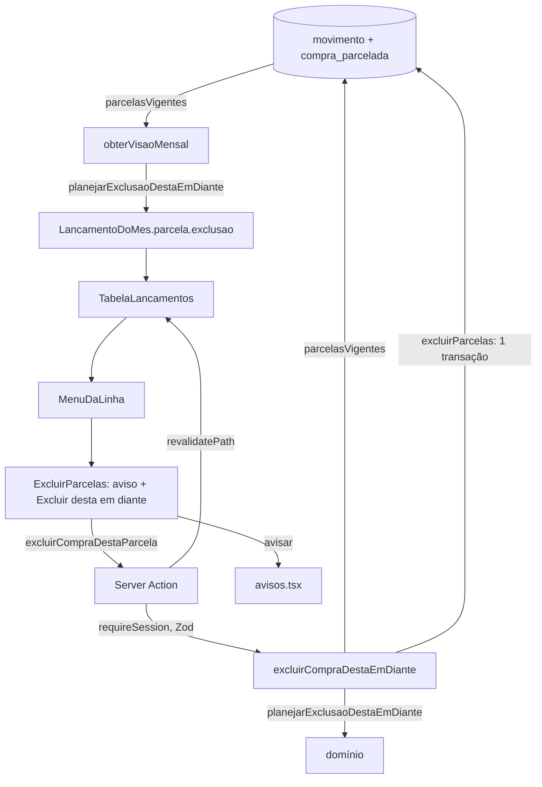

# Excluir compra parcelada desta parcela em diante: Design

**Spec**: `.specs/features/excluir-compra/spec.md`
**Status**: Approved (abordagem escolhida pelo dono em 2026-11-02: aviso calculado na página;
parcela sai por cancelamento lógico)

---

## Architecture Overview

Uma função pura decide o que sai. A página a chama para montar o aviso de cada parcela da lista, e
o caso de uso a chama de novo, no servidor, para gravar. O aviso e a gravação não têm como divergir
de regra, só de dado: se outra aba mudou a compra entre a leitura e o clique, vale o que o servidor
lê, e o toast diz quantas saíram de fato.



---

## Code Reuse Analysis

### Existing Components to Leverage

| Component | Location | How to Use |
| --- | --- | --- |
| `MenuDaLinha` | `src/components/menu-da-linha.tsx` | Passa a receber o conteúdo do menu como `children`; o avulso passa `BotaoExcluir`, a parcela passa `ExcluirParcelas`. `Escape`, clique fora e foco de volta ao "⋯" já existem e servem EXC-02 AC 9 |
| `BotaoExcluir` | `src/components/botao-excluir.tsx` | Sem mudança de comportamento (EXC-01 AC 4); só muda quem o monta |
| `avisar` (toast) | `src/components/avisos.tsx` | Toast de EXC-04 AC 4, com o comportamento de TRC-04 AC 4 |
| `restoDaParcela` | `src/components/texto-da-parcela.ts` | Continua formatando "faltam N" / "última"; muda só o número que recebe |
| `formatarCompetencia`, `formatarBRL` | `src/lib/formatar.ts` | Meses e soma do aviso |
| Padrão de action | `src/app/actions/lancamentos.ts` (`trocarCategoria`, `cancelarLancamento`) | `requireSession` primeiro, Zod, `erroDeAction`, `falhaInesperada`, revalidação de todas as competências |
| Transação com assert de conservação | `CompraRepository.reprecificar` (`compra.repository.ts:79-112`) | Mesmo formato para `excluirParcelas` |
| `Lancamento.canceladoEm` | `src/domain/tipos.ts:94` | Exclusão lógica; toda soma e toda lista já ignoram cancelado (`movimento.repository.ts:32,48`) |

### Integration Points

| System | Integration Method |
| --- | --- |
| Visão mensal | `obterVisaoMensal` troca `totaisDeParcelas` por `parcelasVigentes` e acrescenta `exclusao` em `IdentificacaoDeParcela` |
| Banco | Sem migration: `cancelado_em` já existe em `movimento` |
| Importação | Passa a ignorar parcela cancelada ao reprecificar (ver Risks) |

---

## Components

### `planejarExclusaoDestaEmDiante` (domínio)

- **Purpose**: decidir, a partir das parcelas não canceladas de uma compra e do número escolhido,
  o que sai, o que fica e o total novo.
- **Location**: `src/domain/parcelamento/excluir-desta-em-diante.ts`
- **Interfaces**:
  - `planejarExclusaoDestaEmDiante(compra: CompraVigente, aPartirDe: number): Result<PlanoDeExclusao, ErroDaExclusao>`
  - `restantesDepois(parcelas: ReadonlyArray<ParcelaVigente>, numero: number): number` — parcelas
    não canceladas de número maior (EXC-04 AC 5)
- **Regras**: sai toda parcela de `numero >= aPartirDe` com `paga = false`; `pagasQueFicam` conta as
  de `numero >= aPartirDe` com `paga = true`; `inteira` é não existir parcela de `numero < aPartirDe`;
  `valorTotalNovo = valorAmortizadoAnterior + soma das que ficam`. `aPartirDe` fora da lista vira
  `PARCELA_INICIAL_INVALIDA` (código que já existe); nenhuma parcela a sair vira `NADA_A_EXCLUIR`.
- **Dependencies**: `Cents`, `somar`, `Competencia`, `Result`. Puro (AD-006).

### `CompraRepository.parcelasVigentes` e `excluirParcelas` (infraestrutura)

- **Purpose**: ler as parcelas não canceladas de várias compras numa consulta; cancelar um conjunto
  de parcelas e gravar o total novo numa transação.
- **Location**: `src/application/ports/repositories.ts`, `src/infrastructure/db/repositories/compra.repository.ts`, `src/application/ports/fakes.ts`
- **Interfaces**:
  - `parcelasVigentes(compraIds: ReadonlyArray<string>): Promise<ReadonlyMap<string, CompraVigente & { qtdParcelas: number }>>` — um `SELECT` com `compra_id IN (...) AND cancelado_em IS NULL`, junto do plano
  - `excluirParcelas(compraId: string, numeros: ReadonlyArray<number>, valorTotal: Cents, canceladoEm: string): Promise<void>` — `UPDATE movimento SET cancelado_em` só onde `pago_em IS NULL AND cancelado_em IS NULL`, `UPDATE compra_parcelada SET valor_total_centavos`, e o assert: amortizado + soma das não canceladas = total, senão `ViolacaoDeConservacao` e rollback
- **Reuses**: o formato de `reprecificar`.

### `excluirCompraDestaEmDiante` (caso de uso)

- **Purpose**: EXC-03 e as recusas de EXC-05 ACs 3 a 5.
- **Location**: `src/application/compras/excluir-desta-em-diante/handler.ts`
- **Interfaces**:
  - `excluirCompraDestaEmDiante(deps: { movimentos; compras }, entrada: { lancamentoId: string; agora: string }): Promise<Result<{ alterou: boolean; parcelasExcluidas: number }, { code: CodigoErroExclusao }>>`
- **Fluxo**: `movimentos.buscarPorId` (inclui cancelado) → inexistente: `LANCAMENTO_NAO_ENCONTRADO`;
  sem `compraId` ou `numeroParcela`: `LANCAMENTO_NAO_E_PARCELA`; já cancelado: `ok({ alterou: false, parcelasExcluidas: 0 })`
  (EXC-03 AC 7); senão `parcelasVigentes([compraId])` → domínio → `excluirParcelas`.
- **Reuses**: forma de `cancelar-lancamento/handler.ts`; `agora` vem de fora.

### `excluirCompraDestaParcela` (Server Action)

- **Location**: `src/app/actions/compras.ts`; schema em `src/application/schemas/exclusao-de-compra.schema.ts`
  (`z.strictObject({ lancamentoId: z.uuid() })`)
- **Fluxo**: `requireSession()` primeiro (EXC-05 AC 1) → Zod (`VALIDACAO`, AC 2) → caso de uso →
  `erroDeAction(code)` nas recusas → revalida `/[competencia]`, `/[competencia]/lancamentos`,
  `/[competencia]/simular` (`"page"`) e `/` → `{ ok: true, data: { parcelasExcluidas } }`; exceção →
  `falhaInesperada` (AC 6).
- **Mensagens novas em `src/lib/erros.ts`**: `LANCAMENTO_NAO_E_PARCELA` ("Só parcela de compra se
  exclui por aqui."), `NADA_A_EXCLUIR` ("Todas as parcelas desta em diante já foram pagas. Nada a
  excluir.").

### `textoDaExclusao` (apresentação pura)

- **Location**: `src/components/texto-da-exclusao.ts`
- **Interfaces**:
  - `avisoDaExclusao(descricao: string, exclusao: ExclusaoDaParcela): string` — os textos de EXC-02 ACs 2 a 6 e EXC-05 AC 5
  - `toastDaExclusao(parcelasExcluidas: number): string` — EXC-04 AC 4

### `ExcluirParcelas` (cliente)

- **Location**: `src/components/excluir-parcelas.tsx`
- **Estados**: inicial ("Excluir") → aviso (texto + "Excluir desta em diante" + "Cancelar", foco em
  "Cancelar") → gravando (botão desabilitado) → sucesso (`avisar(toast)`; a revalidação tira a linha)
  ou recusa (`role="alert"`, sem toast). Com `exclusao.tipo === "NADA"`, o aviso não tem o botão de
  excluir. "Cancelar" fecha o menu pelo mesmo caminho do `Escape` (callback `fechar` do `MenuDaLinha`).

### `TabelaLancamentos`

- Monta `MenuDaLinha` também quando `item.parcela !== null`, com `ExcluirParcelas` dentro; o fixo
  continua sem menu (EXC-01 AC 3). A página passa a action como prop, como já faz com `cancelarLancamento`.

---

## Data Models

```typescript
// src/domain/parcelamento/excluir-desta-em-diante.ts
interface ParcelaVigente {
  readonly numero: number;
  readonly competencia: Competencia;
  readonly valor: Cents;
  readonly paga: boolean;
}

interface CompraVigente {
  readonly valorAmortizadoAnterior: Cents;
  /** Só as não canceladas. */
  readonly parcelas: ReadonlyArray<ParcelaVigente>;
}

interface PlanoDeExclusao {
  readonly numeros: ReadonlyArray<number>;      // as que saem
  readonly primeira: Competencia;
  readonly ultima: Competencia;
  readonly total: Cents;                        // soma das que saem
  readonly pagasQueFicam: number;
  readonly inteira: boolean;
  readonly valorTotalNovo: Cents;
}

type ErroDaExclusao =
  | { readonly code: "PARCELA_INICIAL_INVALIDA" }
  | { readonly code: "NADA_A_EXCLUIR"; readonly pagasQueFicam: number };

// src/application/mes/obter-visao-mensal/handler.ts
type ExclusaoDaParcela =
  | { readonly tipo: "NADA" }
  | { readonly tipo: "PLANO"; readonly parcelas: number; readonly primeira: string;
      readonly ultima: string; readonly totalCentavos: number;
      readonly pagasQueFicam: number; readonly inteira: boolean };

interface IdentificacaoDeParcela {
  readonly numero: number;
  readonly total: number;
  readonly restantes: number;           // agora de restantesDepois
  readonly exclusao: ExclusaoDaParcela; // novo
}
```

---

## Error Handling Strategy

| Error Scenario | Handling | User Impact |
| --- | --- | --- |
| Payload inválido | Zod, `VALIDACAO`, sem ler o banco | Mensagem de validação no menu |
| Lançamento inexistente | `LANCAMENTO_NAO_ENCONTRADO` | "Esse lançamento não existe mais." no menu |
| Não é parcela | `LANCAMENTO_NAO_E_PARCELA` | Mensagem no menu; nada gravado |
| Parcela já cancelada | `ok`, `alterou: false` | Nenhum erro; a revalidação tira a linha |
| Nenhuma parcela a sair | Aviso sem botão; o servidor recusa com `NADA_A_EXCLUIR` se chamado | Texto de EXC-05 AC 5 |
| Parcela paga por outra aba entre a leitura e o `UPDATE` | O `UPDATE` não a cancela, o assert falha, rollback | `ERRO_INESPERADO` com referência; nada gravado |
| Falha de banco | Transação desfeita, `falhaInesperada` | `ERRO_INESPERADO` com referência |

---

## Risks & Concerns

| Concern | Location (file:line) | Impact | Mitigation |
| --- | --- | --- | --- |
| O assert de conservação soma parcela cancelada | `src/infrastructure/db/repositories/compra.repository.ts:104-108` | Depois de uma exclusão, toda reprecificação da compra lançaria `ViolacaoDeConservacao` | O `SUM` passa a filtrar `cancelado_em IS NULL`, nos dois asserts; teste de integração com parcela cancelada |
| `buscarUma` devolve parcela cancelada | `compra.repository.ts:131-135` | A importação reprecificaria e somaria parcela excluída, quebrando o total | Filtrar `cancelado_em IS NULL`; teste de integração |
| `reprecificar` grava valor em parcela cancelada | `compra.repository.ts:85-91` | Linha cancelada com valor que ninguém vê, e soma divergente se um dia reativada | `WHERE` com `cancelado_em IS NULL` |
| Fakes divergem do banco | `src/application/ports/fakes.ts` | Teste de caso de uso verde com o banco errado | Teste de integração de `excluirParcelas` e `parcelasVigentes` contra Postgres (AD-010) |
| Aviso calculado na carga da página | `obterVisaoMensal` | Outra aba muda a compra e o aviso fica velho | O servidor recalcula; o toast usa `parcelasExcluidas` da resposta, não o número do aviso |
| Consulta a mais por carga de mês | `obterVisaoMensal` | Latência | Uma consulta `IN` por mês, substituindo `totaisDeParcelas`; ~300 linhas/mês (AD-008) |
| `restantes` hoje é `total - numero` | `obter-visao-mensal/handler.ts:138` | "faltam 2" depois de excluir | `restantesDepois` sobre as vigentes; teste com parcela cancelada |

---

## Tech Decisions

| Decision | Choice | Rationale |
| --- | --- | --- |
| Origem dos números do aviso | Calculados na carga da página, pela mesma função do servidor | Escolha do dono: aviso sem espera e a mesma consulta corrige o "faltam" |
| Remoção | Cancelamento lógico (`cancelado_em`) | Escolha do dono: mesmo mecanismo do avulso; somas e listas já ignoram cancelado |
| Conservação | Amortizado + soma das parcelas **não canceladas** = total | Registrado como AD-027 (vale para toda escrita futura em compra) |
| Transação | Dentro de `CompraRepository.excluirParcelas`, como `reprecificar` | Uma compra só; não precisa da porta `Transacao` |
| Revalidação | Todas as competências de Visão geral, Lançamentos e Simular, e a home | As parcelas que saem podem estar em qualquer mês do horizonte |
| Conteúdo do menu | `MenuDaLinha` com `children` | Um menu, dois conteúdos; evita um segundo menu com as mesmas regras de foco |
