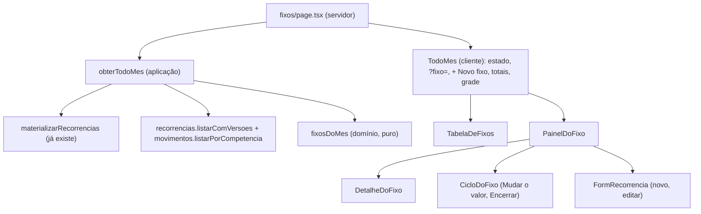

# Todo mês em linhas, com o fixo aberto à direita: Design

Spec: `spec.md` (FIXCOL-01 a FIXCOL-09). Protótipo aprovado: "A · Detalhe à direita" do canvas do
dono. O precedente mais próximo é Lançamentos em lista densa (AD-020): um painel só, que muda de
lugar por CSS, coluna a partir de 1.536 px, lista com até 1.100 px. O mapa de impacto abaixo foi
lido no código, com `file:line`, e corrige as notas do protótipo onde elas não batiam.

## Arquitetura



A página continua lendo no servidor e montando os itens prontos para a tela, como hoje. O que muda:
- **A leitura passa a ser do mês**, por um caso de uso que materializa e lê (FIXCOL-02, AC 3).
- **A regra das linhas e dos totais** mora numa função pura do domínio (FIXCOL-01 a 03).
- **A tela é um componente cliente só**, `TodoMes`, porque o "+ Novo fixo", as linhas e o painel
  dividem o mesmo estado: o que está aberto.

## A regra: `fixosDoMes` (FIXCOL-01 a 03)

`src/domain/recorrencia/fixos-do-mes.ts`, pura, exportada em `src/domain/index.ts`:

```ts
export interface RecorrenciaComVigencias {
  readonly recorrencia: Recorrencia;
  readonly versoes: readonly VersaoRecorrencia[];
}

export interface FixoDoMes {
  readonly recorrencia: Recorrencia;
  readonly versoes: readonly VersaoRecorrencia[];
  /** Valor da ocorrência no mês; `null` sem ocorrência (o fixo ainda não começou). */
  readonly valorDoMes: Cents | null;
  /** Previsto gravado na ocorrência; `null` sem ocorrência. */
  readonly previstoDoMes: Cents | null;
  /** Confirmado diferente do previsto, pelo critério de `tabela-lancamentos.tsx:384-404`. */
  readonly confirmado: boolean;
}

export interface FixosDoMes {
  readonly entradas: readonly FixoDoMes[];
  readonly saidas: readonly FixoDoMes[];
  readonly totalEntradas: Cents;
  readonly totalSaidas: Cents;
}

export function fixosDoMes(
  recorrencias: readonly RecorrenciaComVigencias[],
  lancamentos: readonly Lancamento[],
  competencia: Competencia,
): FixosDoMes;
```

As regras, uma por ramo:
1. **Ocorrência do mês:** lançamento com `origem === "RECORRENCIA"`, da competência, não
   cancelado, indexado por `recorrenciaId`. A restrição única `(recorrência, competência)` garante
   uma por fixo.
2. **Quem aparece:** o fixo que `valeNaCompetencia` (FIXO-07) **ou** que tem ocorrência no mês. O
   segundo ramo é o encerrado com ocorrência paga depois do fim (FIXCOL-02, AC 4).
3. **Seção:** `natureza === "DESPESA"` vai para saídas; o resto, para entradas. É o corte de
   `tabela-lancamentos.tsx:173-174`.
4. **Ordem:** `diaVencimento` crescente, depois `descricao.localeCompare(outra, "pt-BR")`, depois o
   id, para a ordem não depender do banco.
5. **Totais:** saem dos lançamentos, e não das linhas nem das vigências (AD-003):
   - saídas: `despesasDaCompetencia(lancamentos, competencia)` filtrado por origem recorrente, a
     mesma lista que alimenta `resumoMensal(...).competenciaView.fixos` (`resumo-mensal.ts:41-48,125`);
   - entradas: os vigentes da competência, de origem recorrente e natureza diferente de despesa.

**Testes de concordância** no mesmo arquivo de teste (L-014):
- `totalSaidas` é igual a `resumoMensal(...).competenciaView.fixos` para a mesma entrada;
- o total de cada seção é igual à soma de `valorDoMes` das linhas dela, inclusive com um encerrado
  pago depois do fim e um fixo que começa depois.

**Por que o ramo 2 existe.** Encerrar apaga só as ocorrências não pagas (`encerrar/handler.ts:47-49`).
A paga fica no mês e entra no bloco "Fixos" de Lançamentos. Sem a linha, o total de saídas seria
maior que a soma das linhas, e o dono pediu que o total batesse com Lançamentos.

## A leitura: `obterTodoMes`

`src/application/recorrencias/obter-todo-mes/handler.ts`:

```ts
export interface DependenciasTodoMes {
  readonly recorrencias: RecorrenciaRepository;
  readonly movimentos: MovimentoRepository;
}
export async function obterTodoMes(deps: DependenciasTodoMes, competencia: Competencia): Promise<FixosDoMes>;
```

1. `materializarRecorrencias(deps, competencia, MESES_DE_PROJECAO)`, a mesma chamada de
   `lancamentos/page.tsx:119-125`.
2. Depois dela, e não em paralelo, `listarComVersoes()` e `listarPorCompetencia(competencia)`.
3. `fixosDoMes(...)`.

O teste com os fakes de `@/application/ports/fakes` prova a ordem: num mês nunca aberto, a linha vem
com o valor da vigência e o total não é zero. Trocar a ordem, ou apagar a materialização, zera os dois.

## A página (`fixos/page.tsx`)

- Sai a `AreaEstreita`; sai o `DialogoDeCadastro`; sai o parágrafo de explicação do alto.
- Lê `searchParams.fixo` (a página já é `force-dynamic`) e passa como `fixoInicial`. Assim o cliente
  não precisa de `useSearchParams` nem de `Suspense`
  (`node_modules/next/dist/docs/01-app/03-api-reference/04-functions/use-search-params.md`, "If a route
  is prerendered").
- Monta cada `ItemDeFixo` a partir de `FixoDoMes`. Nomes de categoria, meio e pessoa saem dos
  cadastros, como hoje (`fixos/page.tsx:65-76`):
  - **categoria:** "Receita" nas entradas; nas saídas, o nome, "Sem categoria" ou "Categoria
    removida", com a cor de `corDaCategoria` (`null` nas neutras);
  - **valor:** `valorDoMes` e `previstoDoMes` por `formatarBRL`;
  - **histórico:** `versoes` ordenadas por `vigenteDesde`, e `valeNoMes` pela vigência que
    `versaoVigente(versoes, competencia)` devolve;
  - **edição:** `valorNoMesCentavos` continua vindo de `valorNoMesExibido` (`fixos/page.tsx:119`): o
    formulário compara com a previsão vigente, e não com o confirmado (EDF-03, AC 3).

```ts
export interface ItemDeFixo {
  readonly id: string;
  readonly descricao: string;
  readonly natureza: Natureza;
  readonly diaVencimento: number;
  readonly categoria: string;
  readonly corDaCategoria: CorDeCategoria | null;
  readonly meio: string;
  readonly pessoa: string;
  readonly valorDoMes: string | null;
  readonly previstoDoMes: string | null;
  readonly confirmado: boolean;
  readonly inicio: string;          // "Janeiro de 2026"
  readonly comecaDepois: boolean;   // início posterior ao mês aberto
  readonly fim: string | null;
  readonly encerrada: boolean;
  readonly historico: ReadonlyArray<{ readonly desde: string; readonly valor: string; readonly valeNoMes: boolean }>;
  // o que a edição preenche, como hoje em `ItemFixo`
  readonly competenciaInicio: string;
  readonly competenciaFim: string | null;
  readonly meioPagamentoId: string;
  readonly categoriaId: string | null;
  readonly usuarioId: string;
  readonly valorNoMesCentavos: number | null;
}
```

O tipo nasce em `tabela-de-fixos.tsx`, que é o primeiro a usá-lo, e os outros importam de lá.

## A grade (FIXCOL-07)

Um painel só, que muda de lugar por CSS, como o cartão de filtros de Lançamentos
(`lancamentos/page.tsx:199-237`). `TodoMes` desenha:

```
<div class="mx-auto grid w-full max-w-conteudo gap-6 px-4 py-8 sm:px-6 sm:py-10
            2xl:max-w-none 2xl:grid-cols-[minmax(0,1fr)_24rem] 2xl:gap-0 2xl:p-0">
  cabeçalho: h1 "Todo mês" + "+ Novo fixo"     2xl: coluna 1, linha 1   mx-auto max-w-[1100px]
  totais: <dl> com as duas somas                2xl: coluna 1, linha 2   mx-auto max-w-[1100px]
  <div 2xl: coluna 2, linhas 1-3, border-l>     (a linha fina, da altura toda)
    <aside id="painel-do-fixo" aria-label="Painel do fixo"
           2xl:sticky 2xl:top-0 2xl:max-h-dvh 2xl:overflow-y-auto>
  seções: "Entradas fixas", "Saídas fixas"      2xl: coluna 1, linha 3   mx-auto max-w-[1100px]
</div>
```

- **Abaixo de 1.536 px,** a ordem do DOM é a da tela: cabeçalho, totais, painel e seções, numa
  coluna de até 1.024 px. O painel só existe enquanto algo está aberto, num cartão com borda que o
  separa da lista.
- **A partir de 1.536 px,** o invólucro do painel existe sempre: com nada aberto, mostra a dica, e
  abaixo de 1.536 px leva `hidden 2xl:block`. O cartão perde a moldura
  (`2xl:rounded-none 2xl:border-0 2xl:bg-transparent`).
- **Medidas esperadas** (o menu tem 240 px, mais 1 de borda, `menu-lateral.tsx:38`):
  - em 1.536 px, a área à direita do menu tem 1.295 px; tirando a coluna e o respiro, a lista fica
    com uns 860 px;
  - em 1.920 px, a lista bate nos 1.100 px, com uns 97 px de sobra de cada lado.

  A T9 mede e registra o desvio, se houver, como a T4 de Lançamentos.
- **Um id só por coisa:** um `#painel-do-fixo`, um formulário por vez. As consultas dos testes se
  prendem ao painel pelo papel `complementary` e pelo nome "Painel do fixo" (o outro `aside` da
  página é o "Menu do myBilling").

## Componentes

### `TabelaDeFixos` (FIXCOL-01, 02, 04 AC 7)
- **Onde:** `src/components/tabela-de-fixos.tsx` (cliente).
- **Props:** `entradas`, `saidas` (`ItemDeFixo[]` já ordenados), `totalEntradas`, `totalSaidas`
  (texto), `nomeDoMes`, `abertoId: string | null`, `aoAbrir(id)`.
- **Seção:** `<section aria-labelledby>` com `h2` ("Entradas fixas" ou "Saídas fixas") e o resumo
  "N · R$ X". O papel é `region`, com o nome do título.
- **Linha:**
  - **Descrição:** um `<button id="abrir-fixo-<id>" aria-expanded aria-controls="painel-do-fixo">`
    na célula, com a descrição e os selos "Encerrado" ou "Começa em <Mês de Ano>". O `<tr>` também
    abre no clique, para a linha inteira ser alvo.
  - **Categoria:** `Chip` com `cor` nas saídas, `Chip` neutro em "Sem categoria" e "Categoria
    removida", e `Chip tom="positivo"` "Receita" nas entradas. Os selos nunca recebem a cor da
    categoria.
  - **Dia e meio:** "dia N" e o nome do meio, em texto apagado.
  - **Valor:** algarismos tabulares, à direita; "—" sem ocorrência; "confirmado" em 13 px, à
    esquerda do valor, na mesma linha.
- **Altura:** a célula usa o padrão de `tabela-lancamentos.tsx` (`block md:table-cell`, `md:pointer-fine:py-1`).
  O botão tem `min-h-11` no toque e `md:pointer-fine:min-h-9`.
- **Linha aberta:** `bg-surface-strong` e um filete de 2 px na cor primária à esquerda, como no
  protótipo.
- **Vazios:** sem fixo nenhum, um aviso só, no lugar das duas seções; seção vazia, uma linha de
  texto.

### `DetalheDoFixo` (FIXCOL-04, ACs 2 a 6)
- **Onde:** `src/components/detalhe-do-fixo.tsx`.
- **Props:** `item`, `rotuloDaCompetencia`, `nomeDoMes`, `aoMudarValor`, `aoEditar`, `aoEncerrar`.
- **O que mostra:**
  - **valor:** em 30 px, com a nota "em <Mês de Ano>", "confirmado · previa R$ X" ou "Começa em <Mês
    de Ano>";
  - **encerrado:** o aviso;
  - **dados:** `<dl>` com Categoria, meio (rótulo pela natureza, AD-015), "De quem é", "Começou em"
    ou "Começa em", e "Termina em";
  - **histórico:** `<section aria-labelledby>` "Valor ao longo dos meses", com uma `<ol>`;
  - **ações:** "Mudar valor" e "Editar" lado a lado, e "Encerrar" no pé, com `border-t`. Fixo
    encerrado mostra só "Editar".

### `CicloDoFixo` (FIXCOL-05, ACs 1 a 3, 6 e 7)
- **Onde:** `src/components/ciclo-do-fixo.tsx`.
- **O que é:** o `fieldset` de hoje de `lista-de-fixos.tsx:291-364`, tirado do cartão sem mudar
  comportamento: os campos, o pré-preenchimento com o mês aberto, a validação no navegador, a
  mensagem do servidor em `role="alert"`, "Registrar" ou "Encerrar mesmo assim" e "Cancelar".
- **Props:** `modo: "valor" | "encerrar"`, `recorrenciaId`, `descricao`, `competencia`,
  `rotuloDaCompetencia`, `registrarVigencia`, `encerrar`, `aoConcluir`, `aoCancelar`.
- **Título:** ganha um `h3` ("Mudar o valor" ou "Encerrar") no lugar da `legend` invisível.

### `PainelDoFixo` (FIXCOL-04 a 06, FIXCOL-08 ACs 2 e 3)
- **Onde:** `src/components/painel-do-fixo.tsx` (cliente).
- **Props:** `aberto`, `itens`, `focarTitulo` (um número que muda a cada abertura feita pela
  pessoa), `aoFechar`, mais o que o cadastro e o ciclo pedem (as listas e as actions de hoje).
  - `aberto` é um de três: `{ tipo: "nada" }`, `{ tipo: "novo" }` ou
    `{ tipo: "fixo", id, descricao }`.
- **Modos:**

  | Modo | Título (`h2`, `tabIndex={-1}`) | Conteúdo |
  | --- | --- | --- |
  | nada | "Nenhum fixo aberto" | a dica |
  | novo | "Novo gasto fixo ou entrada" | `FormRecorrencia` de cadastro |
  | fixo, detalhe | a descrição | subtítulo e `DetalheDoFixo` |
  | fixo, mudar o valor | a descrição | `CicloDoFixo modo="valor"` |
  | fixo, encerrar | a descrição | `CicloDoFixo modo="encerrar"` |
  | fixo, editar | a descrição | `<section aria-labelledby>` "Editar gasto fixo" ou "Editar entrada", com `FormRecorrencia` em edição e "Voltar" |
  | fixo fora da lista | a descrição | "<descrição> não aparece mais em <Mês de Ano>." |

- **Sub-modo:** detalhe, valor, encerrar ou editar vive no painel, com `key={id}`. Trocar de fixo
  volta ao detalhe e descarta o que foi digitado (FIXCOL-04, AC 9).
- **"Fechar" (✕):** `aria-label="Fechar"`, no canto do título, em todo modo menos "nada".
- **`Escape`:** `onKeyDown` no `aside` chama `aoFechar`.
- **Foco:** quando `focarTitulo` muda, o `h2` recebe o foco; carregar a página com `?fixo=` não muda
  o número e não rouba o foco.
- **Fixo fora da lista:** `aberto.id` deixou de estar em `itens` depois de uma action; o painel usa
  `aberto.descricao`, guardada na abertura.
- **Edição:** o `FormRecorrencia` em edição é o de hoje (`lista-de-fixos.tsx:138-162`), e
  `router.refresh()` dele atualiza a lista e o painel.

### `TodoMes` (FIXCOL-06, FIXCOL-07, FIXCOL-08 ACs 4 e 5, FIXCOL-09)
- **Onde:** `src/components/todo-mes.tsx` (cliente).
- **O que faz:**
  - guarda `aberto` e o número `focarTitulo`;
  - desenha o cabeçalho com "+ Novo fixo", os totais, o painel e a `TabelaDeFixos`, na grade acima.
- **URL:**
  - abrir um fixo: `history.replaceState(null, "", "?fixo=<id>")`;
  - fechar, ou abrir o cadastro: tira o parâmetro. Os outros parâmetros ficam como estão.

  Isso integra com o roteador (`node_modules/next/dist/docs/01-app/01-getting-started/04-linking-and-navigating.md`,
  "Native History API"), e o `router.refresh()` dos formulários relê a página com o mesmo endereço.
- **Estado inicial:** `fixoInicial` vale só se o id está entre os itens; senão, nada aberto
  (FIXCOL-09, AC 3).
- **Devolver o foco:** fechar devolve o foco a `#abrir-fixo-<id>` ou ao "+ Novo fixo", conforme o
  que estava aberto.
- **Abaixo de 1.536 px:** o foco no título já rola a página até ele. A T8 mede o título dentro da
  janela depois de abrir a última linha; se a medida falhar, entra `scrollIntoView({ block: "start" })`.

### `FormRecorrencia` pela largura do contêiner (FIXCOL-07, ACs 7 e 8)
- **Onde:** `src/components/form-recorrencia.tsx`.
- **O que muda:** o `<form>` ganha `@container`. As seis ocorrências de `sm:flex-row`, `sm:w-1/2` e
  `sm:pr-2` (`:404`, `:440`, `:460`, `:500`, `:559`, `:665`) viram `@md:flex-row`, `@md:w-1/2` e
  `@md:pr-2`. `@md` é 28 rem, 448 px, no Tailwind v4.
- **Onde mais vale:** na coluna de 384 px o formulário tem uns 336 px e empilha; em 1.280 px, com o
  painel na largura toda, os pares ficam lado a lado, como hoje.

## Reuso

| O quê | Onde | Como |
| --- | --- | --- |
| Materialização | `src/application/recorrencias/materializar/handler.ts` | Chamada antes da leitura, como em Lançamentos |
| Despesa somável | `despesasDaCompetencia`, `resumo-mensal.ts:41-48` | Base do total de saídas |
| Quem vale no mês | `valeNaCompetencia`, `versaoVigente` | Regra de FIXO-07 e a vigência do mês |
| Valor da edição | `valorNoMesExibido`, `editar/handler.ts:125-130` | Inalterado |
| Formulário | `FormRecorrencia` | Cadastro e edição no painel |
| Ciclo de vida | o `fieldset` de `lista-de-fixos.tsx:291-364` | Vira `CicloDoFixo` |
| Pill e selos | `Chip`, `ui.tsx:63-83` | Cor da categoria, neutra e "Receita" |
| Célula densa | `CELULA` de `tabela-lancamentos.tsx` | Mesma altura com ponteiro fino |
| Grade e coluna presa | `lancamentos/page.tsx:199-237` | Mesmo padrão, coluna de 24 rem |
| Fakes | `@/application/ports/fakes` | Teste de `obterTodoMes` |

## Risks & Concerns

| Concern | Location (file:line) | Impact | Mitigation |
| --- | --- | --- | --- |
| A página não materializa | `fixos/page.tsx:56-61` | Ler ocorrência num mês nunca aberto daria "—" e total zero | `obterTodoMes` materializa antes de ler; teste com fakes (T2) e e2e que abre Todo mês primeiro (T8, L-001) |
| Histórico descartado | `fixos/page.tsx:92-121` | "Valor ao longo dos meses" sem dado | A página passa `versoes` adiante (T8) |
| Ocorrência paga depois do fim | `encerrar/handler.ts:47-49` | Total maior que a soma das linhas | Ramo 2 de `fixosDoMes` e teste de concordância (T1) |
| Ausência provada por `listitem` | `recorrencias.spec.ts:243`, `:248` | Com a tabela, "nenhum `listitem` com Internet" passa sem provar nada | Trocar por `row` na mesma task que troca a lista (T8); a Review Focus manda conferir |
| Texto procurado na tela inteira | `recorrencias.spec.ts:178`, `:181` | "R$ 180,00" aparece na linha, no título da seção e no total; o `getByText` falha por ambiguidade | Prender à linha do fixo (T8, L-018) |
| Campos espremidos na coluna | `form-recorrencia.tsx:404,440,460,500,559,665` | Uns 160 px por campo em 384 px | `@container` (T10) |
| Texto velho no vazio | `lista-de-fixos.tsx:112-115` ("Cadastre abaixo") | Aponta para um formulário que saiu do rodapé em AD-014 | Texto novo (FIXCOL-01, AC 12) |
| Duas leituras de `listarComVersoes` | `materializar/handler.ts:45` e `obterTodoMes` | Uma consulta a mais por página | Aceito: menos de 5 ms, AD-008. Mudar a materialização para devolver a lista mexeria em três telas |
| GET que escreve | `materializarRecorrencias` | A tela passa a criar ocorrência ao abrir | Mesma decisão já registrada em recorrências; Lançamentos e Visão geral já fazem |
| Navegação entre meses sem a query | `seletor-competencia.tsx:104,144` | O painel abre fechado no outro mês | Aceito e registrado como Edge Case |
| Comentários que deixam de ser verdade | `area-estreita.tsx:3-12`, `dialogo-de-cadastro.tsx:82-86`, `form-recorrencia.tsx:351-354`, `form-recorrencia.test.tsx:216-219,233` | Documentação mentindo | T11 |

## Tech Decisions

| Decision | Choice | Rationale |
| --- | --- | --- |
| Onde mora o estado | `TodoMes`, componente cliente que desenha a grade inteira | O botão do topo, as linhas e o painel dividem o mesmo "aberto"; um contexto só para isso seria mais peça |
| `?fixo=` | Lido no servidor, escrito com `history.replaceState` | Sem `useSearchParams`, sem `Suspense` e sem ida ao servidor a cada clique |
| Papel do painel | `<aside aria-label="Painel do fixo">` | Nome estável para os testes; o título muda com o conteúdo |
| Papel da linha | `button` com `aria-expanded` e `aria-controls` | Padrão de divulgação, como o protótipo; `aria-pressed` diria "alternar", e o que acontece é abrir |
| Novo componente em vez de reescrever `ListaDeFixos` | `TabelaDeFixos`, `DetalheDoFixo`, `CicloDoFixo`, `PainelDoFixo` e `TodoMes` nascem ao lado, e a página troca de uma vez na T8 | A página continua funcionando, e o e2e verde, a cada commit; `lista-de-fixos.tsx` sai na T8, com cada teste dele portado antes (tabela abaixo) |

## Testes que mudam porque a spec mudou

Nenhuma mudança afrouxa o que o teste prova. Cada uma acompanha uma regra nova aprovada pelo dono ou
registrada como decisão do autor na spec.

| Teste | Por quê | Mudança |
| --- | --- | --- |
| `recorrencias.spec.ts:45-55`, `:57-70` (cadastro) | Cadastro no painel, sem `<dialog>` (FIXCOL-06) | O formulário procurado no painel, e não no diálogo |
| `recorrencias.spec.ts:87-109` (AVUL-05, AC 8) | Lista em tabela | A posição da linha (`row`), e não do `listitem` |
| `recorrencias.spec.ts:149-153`, `:171-175`, `:222-225` | "Mudar valor" e "Encerrar" no painel (FIXCOL-05) | Abrir a linha do fixo antes |
| `recorrencias.spec.ts:161-182` | Valor do mês (FIXCOL-02) e totais na tela (FIXCOL-03) | Os mesmos R$ 180,00 em março e R$ 240,00 em maio, lidos na linha |
| `recorrencias.spec.ts:236-260` (FIXO-07) | Lista em tabela | `row` no lugar de `listitem`; sem isso a ausência em maio passa vazia |
| `recorrencias.spec.ts:263-284` | Cadastro no painel | Mesmo percurso, no painel |
| `editar-fixo.spec.ts:51-65` | Cadastro no painel | Idem |
| `editar-fixo.spec.ts:75-86`, `:88-92` (EDF-01, ACs 1 e 2; EDF-06, AC 6) | "Editar" e confirmação no painel | Abrir a linha, "Editar", a região "Editar gasto fixo" do painel |
| `editar-fixo.spec.ts:107-131` | Sem diálogo modal | A linha renomeada aparece uma vez e o painel continua com a confirmação; `Escape` fecha o painel |
| `trocar-categoria.spec.ts:55-86` | Cadastro no painel | Formulário no painel |
| `categorias.spec.ts:226-232` (`pillDoFixo`) | Lista em tabela | A pill dentro da `row` do fixo |
| `importacao.spec.ts:200-208` (IMP-07) | Lista em tabela | `row` no lugar de `listitem`; os mesmos "R$ 110,00" e "Conta Corrente" |
| `visao-tres-colunas.spec.ts:208-235` (TRES-01, AC 8) | Todo mês deixa a `AreaEstreita` a partir de 1.536 px | O laço fica só com Categorias (T9) |
| `visao-tres-colunas.spec.ts:596-611` (400 px) | Roda em 400 px | Nada muda |

## Para onde vai cada teste de `lista-de-fixos.test.tsx`

`lista-de-fixos.tsx` sai na T8. Antes disso, cada teste dele tem um equivalente no componente que
herdou a regra. O Verifier confere esta tabela.

| Teste de hoje (linha) | Vai para | Observação |
| --- | --- | --- |
| sem nenhum, explica o que fazer (119) | `tabela-de-fixos.test.tsx` (T3) | Texto novo, sem "abaixo" |
| valor vigente e dia de vencimento (125) | `tabela-de-fixos.test.tsx` (T3) | Regra nova: valor da ocorrência (FIXCOL-02) |
| travessão antes da vigência (132) | `tabela-de-fixos.test.tsx` (T3) | Mais o selo "Começa em" |
| encerrada marcada e sem controles (138) | `tabela-de-fixos.test.tsx` (selo) e `detalhe-do-fixo.test.tsx` (só "Editar") | T3 e T4 |
| receita distinguida por selo (146) | `tabela-de-fixos.test.tsx` (T3) | "Receita" na coluna Categoria, dentro de "Entradas fixas" |
| pill na cor da categoria, nome na pill, removida neutra, selos sem cor (176, 189, 195, 205) | `tabela-de-fixos.test.tsx` (T3) | Consulta presa à linha (L-018) |
| mudar valor: competência, centavos, texto inválido, cancelar (225, 235, 254, 266) | `ciclo-do-fixo.test.tsx` (T5) | Mesmas assertions |
| encerrar: aviso, competência, botão diferente, erro em alerta (279, 288, 302, 310) | `ciclo-do-fixo.test.tsx` (T5) | Mesmas assertions |
| cada linha abre o seu controle (326) | `painel-do-fixo.test.tsx` (T6) | Regra nova: um painel; trocar de fixo descarta o digitado (FIXCOL-04, AC 9) |
| "Editar" em cada cartão; no encerrado também (373, 386) | `detalhe-do-fixo.test.tsx` (T4) | Regra nova: no painel (FIXCOL-04, AC 5) |
| abre num diálogo com o título (392, dois casos) | `painel-do-fixo.test.tsx` (T6) | Regra nova: região do painel com o mesmo título (FIXCOL-05, AC 4) |
| abre com o fixo e salva com os ids (410) | `painel-do-fixo.test.tsx` (T6) | Mesmo payload |
| confirmação sem fechar (435) | `painel-do-fixo.test.tsx` (T6) | No painel (FIXCOL-05, AC 5) |
| reabrir mostra o gravado (451) | `painel-do-fixo.test.tsx` (T6) | "Voltar" e "Fechar" descartam o digitado |

## e2e novo: `e2e/todo-mes-colunas.spec.ts`

Março de 2026, semeado pelo banco, com nomes genéricos e valores redondos (AD-009):
- **Fixo A:** despesa, dia 5, Categoria Um. Vigências: janeiro, R$ 90,00; fevereiro, R$ 100,00;
  maio, R$ 110,00. A ocorrência de março já entra gravada, confirmada em R$ 105,00 sobre R$ 100,00.
- **Fixo B:** despesa, dia 10, R$ 50,00. Sem ocorrência: a tela a cria.
- **Fixo C:** despesa, dia 10, com fim em fevereiro e encerrado. A ocorrência de março entra paga,
  R$ 30,00.
- **Fixo D:** despesa, dia 1, começa em junho, R$ 70,00.
- **Entrada A:** receita, dia 5, R$ 1.000,00. Sem ocorrência.

Esperado em março:
- **Saídas fixas:** R$ 185,00 (105 + 50 + 30), na ordem D, A, B, C. D vem primeiro pelo dia, embora
  seja o último no alfabeto; B e C empatam no dia e seguem o alfabeto.
- **Entradas fixas:** R$ 1.000,00.
- **Lançamentos de março:** o título do bloco "Fixos" mostra os mesmos R$ 185,00.

| Task | Largura | O que mede |
| --- | --- | --- |
| T8 | 1.280 px | Abrir Todo mês primeiro: linhas com valor e totais certos (materialização, L-001); a concordância com Lançamentos (L-014); "confirmado" na linha de A; C com "Encerrado"; D com "—" e "Começa em Junho de 2026"; o painel de A com o histórico na ordem e "vale em Março"; mudar o valor, editar e encerrar pelo painel; o cadastro pelo painel; `?fixo=` e recarregar; `Escape` e o foco de volta; o painel entre os totais e as seções; toda linha com até 48 px |
| T8 | 400 px | Sem rolagem lateral, com um fixo aberto; cada fixo em duas linhas de texto; alvos de 44 px |
| T9 | 1.535 e 1.536 px | O limiar dos dois lados: painel acima das seções a 1.535 px e à direita a 1.536 px; sem nada aberto, nenhum painel a 1.535 px e a dica a 1.536 px |
| T9 | 1.536 e 1.920 px | Coluna de 384 px com `border-left` computado de 1 px; seções com até 1.100 px, centradas; o título do painel à vista depois de rolar até o fim (janela de 480 px de altura); toda linha com até 48 px |
| T10 | 1.536, 1.920 e 1.280 px, e duas janelas em volta de 448 px de formulário | Na coluna, um campo por linha; em 1.280 px, valor e dia lado a lado. No limiar, o teste mede a largura do formulário e confere que os pares só ficam lado a lado com 448 px ou mais |

## Decisão de projeto: AD-021 (texto para o `STATE.md`, na T11)

### AD-021
- **Decision**: Todo mês vira uma lista em linhas com o fixo aberto num painel:
  - **Linhas:** uma por fixo, sem botão, em "Entradas fixas" e "Saídas fixas", pelo dia de
    vencimento. O valor de cada linha e os totais do alto são os da ocorrência do mês aberto
    (`movimento`); o total de saídas é o do bloco "Fixos" de Lançamentos.
  - **Painel:** abrir um fixo mostra os dados, o valor ao longo dos meses e "Mudar valor", "Editar" e
    "Encerrar". "+ Novo fixo" e "Editar" abrem o formulário no painel, sem diálogo.
  - **A partir de 1.536 px:** o painel é uma coluna de 384 px, presa à direita da lista, que tem até
    1.100 px. Abaixo disso, uma coluna só, com o painel entre os totais e a lista enquanto algo está
    aberto.
  - **Endereço:** o fixo aberto fica em `?fixo=<id>`.
- **Reason**: é a opção A que o dono escolheu no protótipo, com as três respostas de 2026-10-30. Os
  cartões altos, com três botões cada, deixavam dez fixos maiores que a tela. O valor do cartão era a
  previsão, e não o mês. O histórico de vigências era lido e jogado fora. A largura extra vira
  coluna, como em AD-019 e AD-020.
- **Revê**:
  - AD-014 em Todo mês: sem diálogo de cadastro nem de edição;
  - AD-019 e TRES-01, AC 8 em Todo mês: a tela deixa a `AreaEstreita` a partir de 1.536 px;
  - EDF-01, ACs 1 e 2, e EDF-06, AC 6: "Editar" e a confirmação no painel;
  - AVUL-05, AC 8: o cadastro no painel, e não no diálogo;
  - FIXO-07, AC 1: o fixo encerrado aparece no mês que tem ocorrência dele.
- **Trade-off**: Editar, mudar o valor e encerrar pedem um clique a mais, para abrir a linha. Abaixo
  de 1.536 px o painel abre acima da lista, longe da linha clicada; o foco leva a pessoa até ele.
  A tela passa a materializar ao abrir, como Lançamentos e a Visão geral. Fechar o painel descarta o
  que foi digitado, como fechar o diálogo já fazia.
- **Scope**: `fixos/page.tsx`, `obterTodoMes`, `fixosDoMes`, `TodoMes`, `TabelaDeFixos`,
  `PainelDoFixo`, `DetalheDoFixo`, `CicloDoFixo` e `FormRecorrencia` (largura pelo contêiner). Sai
  `ListaDeFixos`.
- **Date**: 2026-10-30
- **Status**: active
